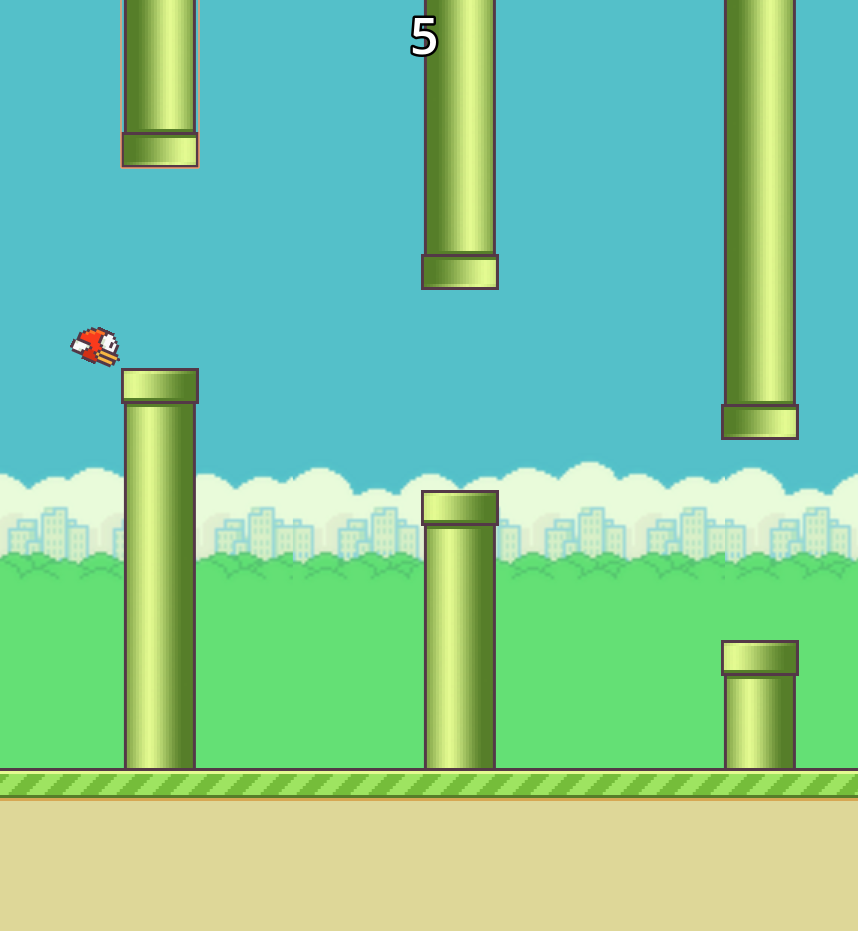
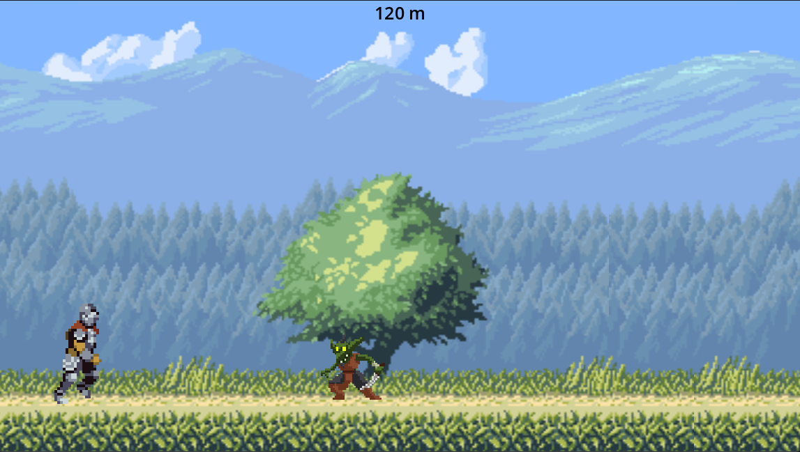
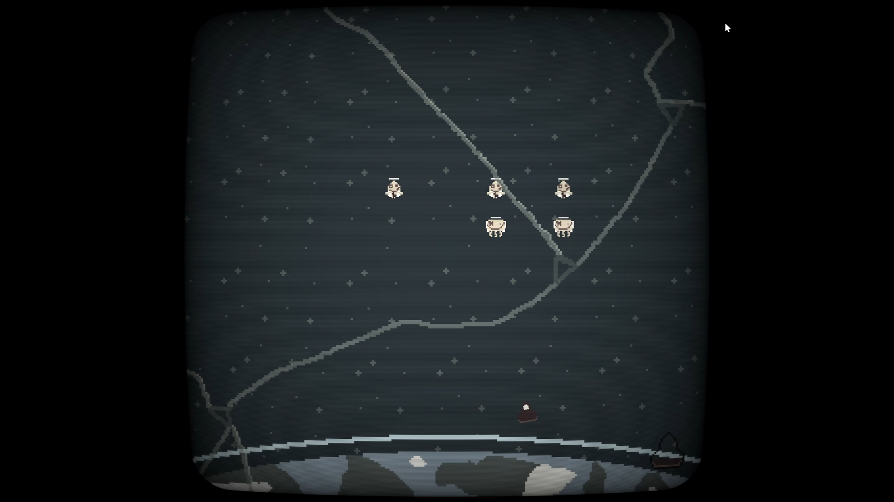
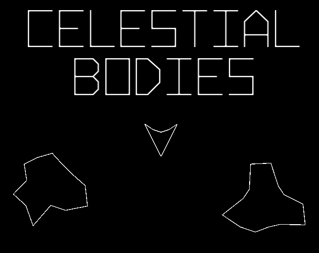
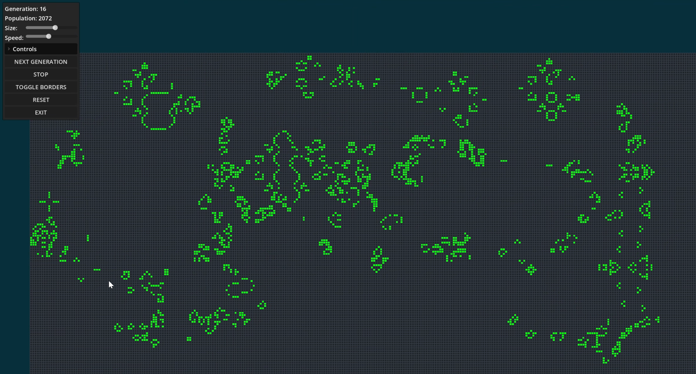
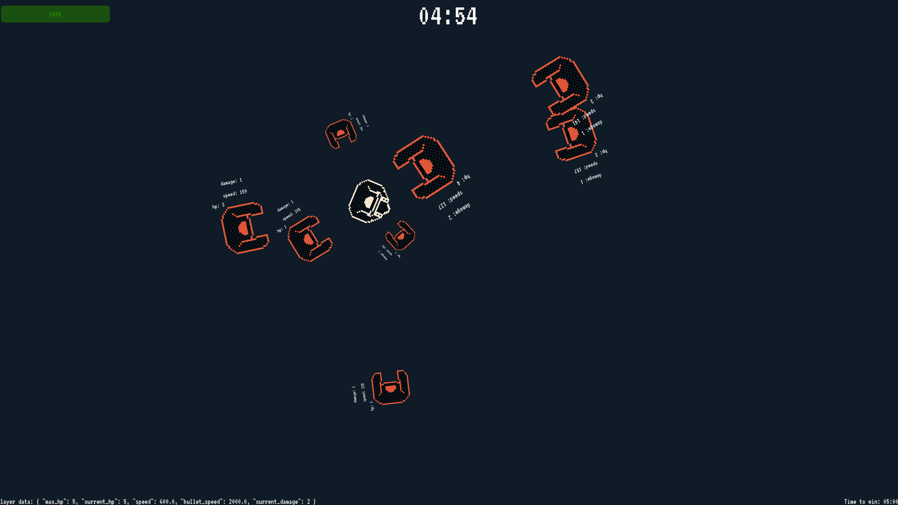

# 20 Games Challenge Catalog <!-- omit in toc -->

[20 games challenge's](https://20_games_challenge.gitlab.io/) goal is to create 20 small games as a fun and practical way to learn game development. The first 10 focus on fundamentals and introducing key concepts, while the last 10 are chosen from a curated list of games related to the games you want to make.

This repo is catalogue of all my projects for the challenge. Each game has its own repository, and they will all be linked here as they're done. All the games will (probably) be developed using [Godot.](https://godotengine.org/)

## Table of Contents <!-- omit in toc -->

- [1. Flappy Bird](#1-flappy-bird)
- [2. Jetpack Joyride](#2-jetpack-joyride)
- [3. Space Invaders](#3-space-invaders)
- [4. Asteroids](#4-asteroids)
- [5. Conway's Game of Life](#5-conways-game-of-life)
- [??. SURVIVE 5 MINUTES](#-survive-5-minutes)

## 1. Flappy Bird

Flappy Bird, endless side-scroller with obstacles and scores. Remake.  
**Concepts Learned**: game engine basics, creating/destroying/moving objects, processing player input, detecting/reacting to collisions.  
Repo: https://github.com/yasukawa426/flappy-bird-clone  

## 2. Jetpack Joyride

Jetpack Joyride clone, I took more libertities this time, tho.  
**Concepts Learned**: classes and inheritance in GDScript, proper parallaxing, a little of animation player, runtime node instanciation and signal handling.  
Repo: https://github.com/yasukawa426/jetpack-joyride-clone

## 3. Space Invaders

Space Invaders clone, but with one catch: I made all the art myself. I drew all the sprites using [LibreSprite](https://libresprite.github.io/#!/). I also changed the theme a bit. Instead of aliens, angels are invading Earth.

**Concepts Learned**: a little about shaders and what you can do with them, libresprite, complex enemy behavior.  
Repo: https://github.com/yasukawa426/space-invaders-godot/

## 4. Asteroids

Asteroids clone. My personal goal this time was no scope creep and just try to finish it as soons as possible. I think it took me 3 days to get it done so pretty good. I could have finished faster but I procrastinated a bit.

**Concepts Learned**: polygons, animation player (very cool), less ugly menus.  
Repo: https://github.com/yasukawa426/asteroids-clone-godot

## 5. Conway's Game of Life

Its [Conway's Game of Life](https://en.wikipedia.org/wiki/Conway%27s_Game_of_Life) implemented in Godot. Made in 2 days!

Repo: https://github.com/yasukawa426/conways-life-game-godot

## ??. SURVIVE 5 MINUTES

Simple top-down shooter. All sprites were made by me. I added some visual effects to polish a little of the game, but the highlight in my opinion were the SFX. They made the game so much better, it's crazy.  
**Concepts Learned**: Some shading, tween animation, particle effects, first time using hit-stops, some pixel-art.  

Repo: https://github.com/yasukawa426/top-down-shooter

